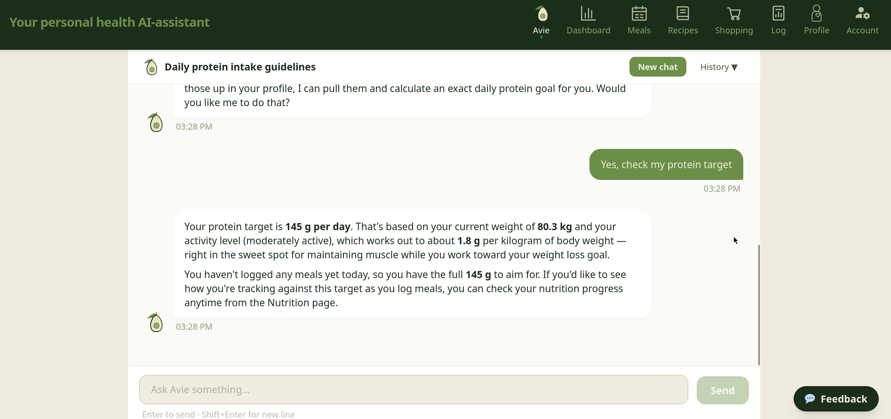
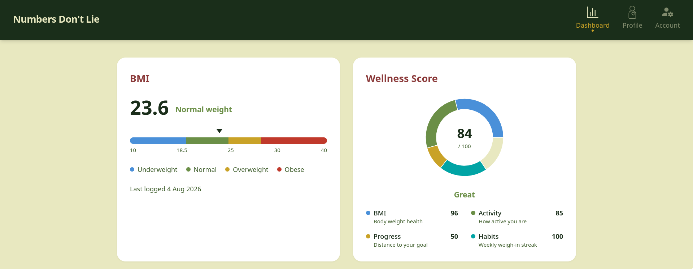
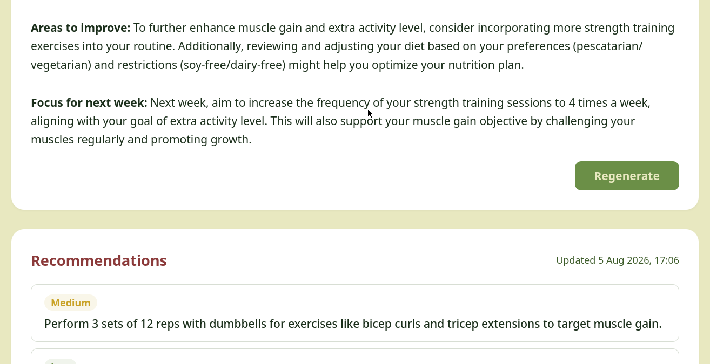
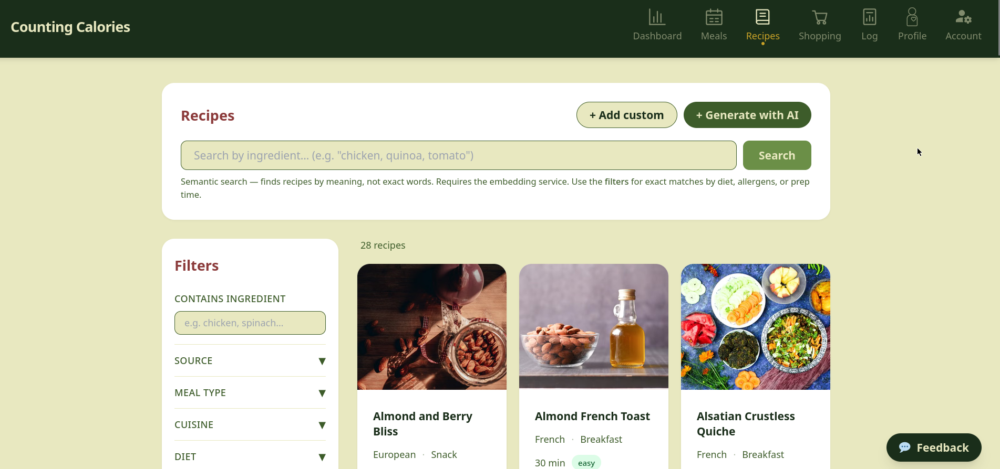
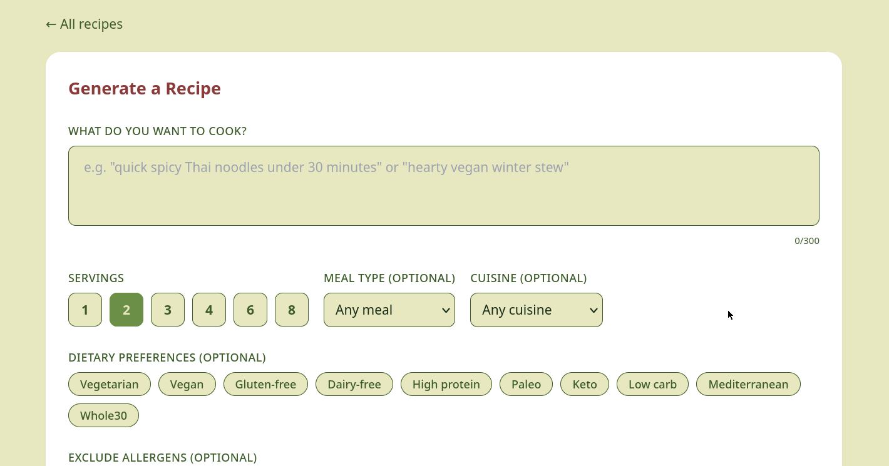
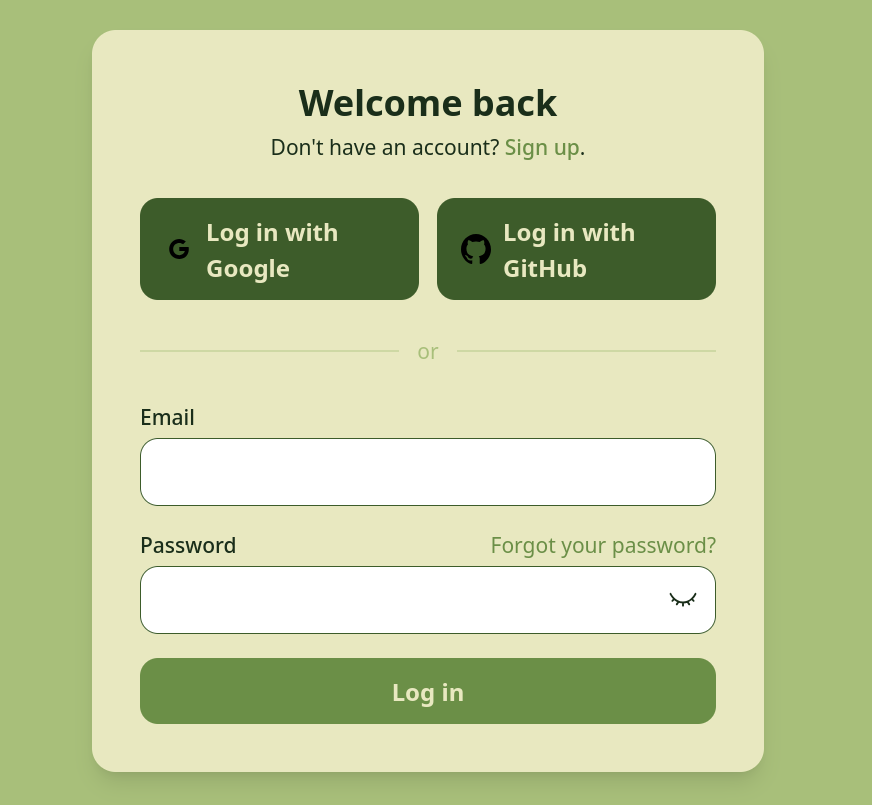

# Avie — AI-Powered Wellness & Nutrition Platform

A full-stack health app that grew over three projects: a **wellness tracker**, then an **AI meal planner**, then **Avie**, a conversational assistant that answers questions about your own health data in plain language.

Built in a team of two at [kood/Jõhvi](https://kood.tech) as part of the Generative AI curriculum.

<!-- VIDEO: replace this block with your demo. Two options:
     1) Drag your .mp4 file into this README on github.com (edit mode) — GitHub embeds a player (max 10 MB on free plans).
     2) YouTube: 
     ▶️ **[Watch the 3-minute demo](#)**
-->

> **About the source code:** the code is private because it's part of a school curriculum. This repository shows what the app does and how it was built.

---

## The journey: three projects, one app

| | Project | What it added |
|---|---------|---------------|
| 1 | **Numbers Don't Lie** | Health profile, BMI and wellness score, progress dashboard, AI-generated health insights, secure login |
| 2 | **Counting Calories** | 780+ recipes, AI recipe generation grounded in real data, personalised meal plans, nutrition tracking, shopping lists |
| 3 | **AI Assistant (Avie)** | A chat assistant that ties everything together: ask about your meals, recipes, or progress and get answers based on *your* data |

Each project was built on top of the previous one, so the final app contains all three.

---

## Features

### 1. Wellness dashboard
See your BMI, a wellness score (0–100) built from four factors, and your progress toward your goal.

### 2. Personal AI insights
The AI reads your health profile and gives weekly recommendations, ranked by priority.

### 3. Recipe library with smart search
Browse 780+ recipes and filter by diet, allergens, cuisine, and cooking time. The search understands *meaning*: "something light with fish" finds the right dishes even if those words aren't in the recipe.

### 4. AI recipe generation
Describe what you want to cook and the AI creates a recipe that respects your diet and allergies. Nutrition values are calculated from a real ingredient database, not guessed by the AI.

Other recipe tools: swap an ingredient for an AI-suggested alternative, change portions, and see 11 micronutrients compared with recommended daily values.

### 5. Meal planning and shopping lists
Generate a daily or weekly meal plan based on your goals and preferences. Swap or regenerate single meals, restore earlier versions of a plan, and turn the plan into a shopping list grouped by store section.

### 6. Avie, the AI assistant
Ask questions such as *"What did I eat today?"*, *"Is that enough protein?"* or *"How is my weight changing?"*. Avie:
- looks up only the data each question needs
- remembers the conversation, so follow-up questions work
- shows charts inside the chat when they help
- has safety guards: it never shares personal data, redirects medical questions to professionals, and resists prompt manipulation

### 7. Secure accounts
Email login, Google and GitHub sign-in, and two-factor authentication.

---

## AI techniques used

| Technique | What it means in this app |
|-----------|---------------------------|
| **RAG (Retrieval-Augmented Generation)** | Before generating a recipe, the app finds similar real recipes in the database and gives them to the AI as examples. The AI adapts real recipes instead of inventing them, which avoids wrong amounts and made-up nutrition. |
| **Vector search (embeddings)** | Recipes are turned into vectors so the search can find them by meaning, not just by matching words. |
| **Function calling** | The AI asks the app to fetch data or calculate nutrition instead of doing the maths itself. Numbers are always accurate. |
| **Sequential prompting** | Meal plans are created in three steps: strategy → daily structure → specific recipes, the same way a nutritionist would plan. |
| **Context management** | Long conversations are summarised automatically, so Avie remembers earlier messages without running out of memory. |
| **Prompt caching** | Repeated instructions are cached, which cuts AI costs by about 70% after the first message. |
| **Safety guardrails** | Personal data, medical, and prompt-injection checks run on every message before it reaches the AI. |

---

## Tech stack

| Layer | Technology |
|-------|-----------|
| Frontend | React 19, TypeScript, Vite, Tailwind CSS, Recharts |
| Backend | Node.js, Express, TypeScript |
| Database | PostgreSQL with pgvector |
| AI | Anthropic Claude API, Ollama (local models and embeddings) |
| Auth | JWT, Google & GitHub OAuth, two-factor authentication |
| DevOps | Docker, Docker Compose |

---

## Team

Built together with **Sergiu Frunze** <!-- add Sergiu's GitHub link here: ([@handle](https://github.com/handle)) -->. Each of us owned features end to end, from database to UI.

**My part (Anastasiia Matrunich):**
- Authentication (JWT, OAuth, 2FA), health profile forms and the dashboard
- UI/UX design and documentation across all three projects
- RAG pipeline and vector search
- Recipe management: search, filters, AI generation, ingredient substitution, portions
- Nutrition tracking: meal logging, calorie trends, micronutrients
- Avie: database design, nutrition and recipe data tools, system prompt design, chat interface, inline charts

**Sergiu's part:** app architecture, health calculations, meal planning engine, shopping list API, Avie's conversation loop, context management and safety guardrails.

---

## Contact

<!-- Add your LinkedIn / email / portfolio here -->
Anastasiia Matrunich · [LinkedIn](https://www.linkedin.com/in/anastasia-matrunich)
